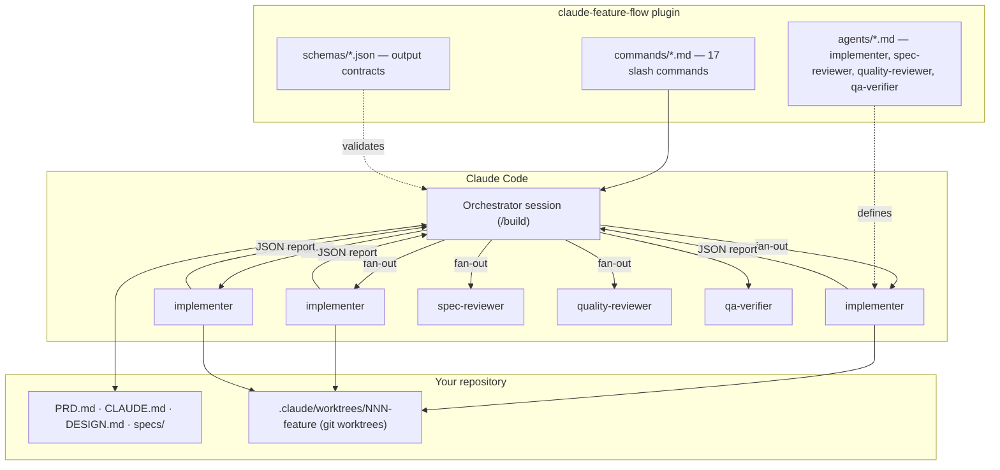

# Architecture overview

## Layers

| Layer | Files | Role |
|---|---|---|
| Procedures | `commands/*.md` | Slash commands: state detection, gates, artifact templates, orchestration logic |
| Workers | `agents/*.md` | Role, tool restrictions and output contract of each subagent |
| Contracts | `schemas/*.schema.json` | Machine-checkable shape of every agent report |
| Memory | `PRD.md`, `specs/**` | The only state; versioned with the code |
| Isolation | git worktrees | Feature-level and worker-level isolation |

## Invariants

1. **One writer per artifact.** Workers never edit `tasks.md`, `spec.md`, `plan.md`, `review.md`; the orchestrator does.
2. **Barrier before fan-in.** No partial worker output is read.
3. **No unvalidated output.** A report without a valid JSON block is a failure, never guessed.
4. **Scope is a contract.** Workers write only inside `Files`; the orchestrator verifies it with git.
5. **Authors don't review.** Reviewers are separate read-only agents.
6. **Human gates are never automated away.** Spec, plan, commit message, squash message.
7. **Resume from disk.** Any command can be re-run after any interruption.

## Release automation

`.github/workflows/version-bump.yml` bumps `plugin.json` and `marketplace.json` on every push to `main` from the Conventional Commit header of the merge commit (`feat!:` → major, `feat:` → minor, `fix:`/`perf:`/`refactor:` → patch) and pushes a matching `vX.Y.Z` tag. Versions are never edited by hand. See [Contributing](../contributing.md).
