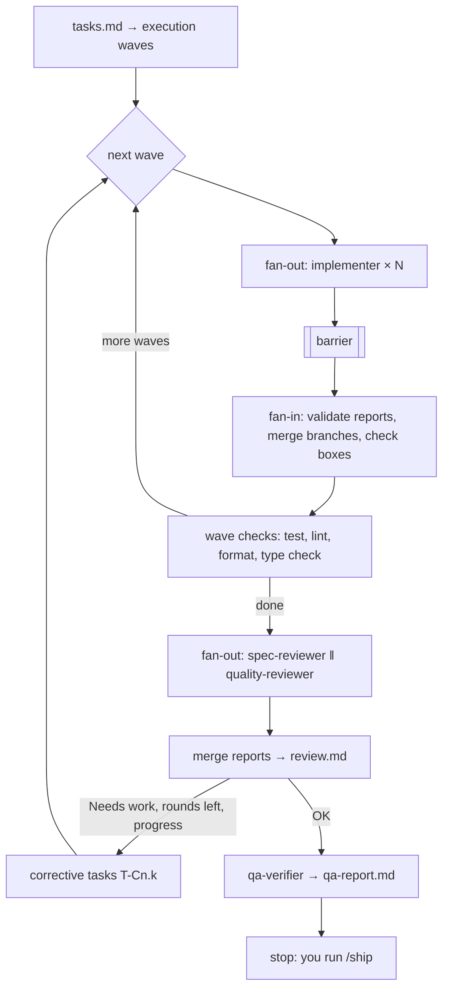

# Orchestration

`/build` is an **orchestrator**: it never writes feature code. It dispatches workers, waits for all of them, validates their structured reports, merges the results, and updates state. Workers and reviewers run in fresh contexts, which keeps the orchestrator's context small even on large features.

## Vocabulary

| Term | Meaning |
|---|---|
| **Orchestrator** | The `/build` session. Only writer of `tasks.md` and `review.md`. |
| **Worker** | An `implementer` subagent doing exactly one task. |
| **Wave** | A set of tasks that can run at the same time (acyclic dependencies, disjoint `Files`). |
| **Fan-out** | Launching the workers of a batch in a single message so they run concurrently. |
| **Barrier** | The orchestrator reads nothing until every worker of the batch has returned. |
| **Fan-in** | Validating each report, scope-checking, merging, and updating state. |
| **Convergence** | Turning review findings into corrective tasks and rebuilding until clean. |

## Waves

`/tasks` computes waves:

1. `wave(T) = 1` without dependencies, else `1 + max(wave(dependency))`. A cycle is an error.
2. Two tasks of the same wave whose `Files` overlap (same file, or a directory containing the other's file) are separated: the later one moves to the next wave.
3. Tasks sharing a wave with another task get `[P]`.

`/build` re-validates this before launching: dependencies exist, no cycle, disjoint `Files`. A `tasks.md` without `Depends-on`/`Files` runs one task per wave, in order.

## One wave, step by step

1. **Select** the ready tasks (unchecked, dependencies checked), at most `--parallel` (default 3).
2. **Prompt** each worker with the task block and the paths of the artifacts. The orchestrator never pastes or reads source code.
3. **Fan-out** all workers in one message.
4. **Barrier.**
5. **Fan-in:** parse each worker's JSON report ([schema](../../schemas/implementer.schema.json)); verify scope; merge (worktree mode); check the task's box.
6. **Wave checks:** test, lint, format and type check run **once**, on the integrated tree.
7. **Retry once** any failed task. Still failing or blocked → the build stops with an actionable message.

Isolation details (worktrees, base guard, merge conflicts) are in [Parallelism and worktrees](parallelism-and-worktrees.md).

## Independent review

After the last wave, `/review` launches two read-only agents in parallel:

- **`spec-reviewer`** — acceptance criteria with evidence, traceability, architecture decisions, constitution, design system, scope creep.
- **`quality-reviewer`** — build commands and the quality of the feature's diff.

Neither wrote the code and neither knows how it was produced; a green checkbox is a claim, not evidence. The orchestrator merges their JSON reports into `review.md` and computes the verdict with mechanical rules ([State machine](state-machine.md#review-verdict-mechanical)).

## Convergence loop

On "Needs work", for `round = 1 … --max-rounds` (default 2):

1. Each `blocker`/`major` issue and each failing AC becomes a corrective task `T-C{round}.{k}` in a `Phase C{round}` section (with `Covers`, `Depends-on`, `Files`, **Do** = the reviewer's fix, **Test**). Waves are recomputed. `minor` issues stay as notes.
2. The waves run again (only the new unchecked tasks).
3. The review runs again and the round is recorded in `## Convergence History`.

The loop stops when the verdict clears, when `--max-rounds` is reached, or when a round makes **no progress** (failing ACs plus blocker/major issues did not decrease). It then hands the decision to you with the remaining issues.

## Human gates preserved

The orchestrator never skips: spec approval (before `/plan`), plan review (before `/tasks`), the commit-message confirmation in `/ship`, and the squash-message confirmation in `/merge`. `/build` stops after QA in quick mode and hands over to `/ship` in full mode.

## Why not a script?

The orchestration is specified in Markdown so it works anywhere slash commands work. A deterministic script version (Claude Code dynamic workflow) is planned for 2.1 on the same contracts — see [decision records](../architecture/decisions.md#adr-006-markdown-orchestrator-first-workflow-script-later).
