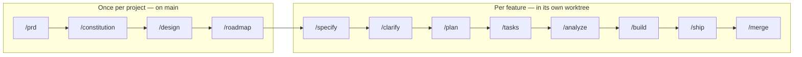

# The workflow

Every arrow is a **human decision**: you run the next command when you are satisfied with the previous artifact. `/build` automates the section between `/tasks` and `/ship`, and `/status` always tells you the next command.

## Phases

| Phase | Command | Produces | Human gate |
|---|---|---|---|
| Discover | `/prd` | `PRD.md` | You answer the interview; the file is written after you approve |
| Govern | `/constitution` | `specs/constitution.md` | You approve the principles |
| Design | `/design` | `DESIGN.md` | You answer the interview; confirm before writing |
| Sequence | `/roadmap` | `specs/roadmap.md` | You approve scope and order |
| Specify | `/specify` | worktree, branch, `spec.md` | You review the spec |
| Clarify | `/clarify` | updated `spec.md` | You answer the questions |
| Plan | `/plan` | `plan.md` | You review the architecture |
| Break down | `/tasks` | `tasks.md` (with waves) | You review tasks and coverage |
| Verify artifacts | `/analyze` | a printed report | You decide what to fix |
| Build | `/build` or `/implement` | code, `review.md`, `qa-report.md` | Stops on any failure; full mode ends in `/ship`, which asks you to confirm the commit message |
| Review | `/review` | `review.md` | Verdict is mechanical; you read it |
| Audit | `/qa` | `qa-report.md` | You read it |
| Ship | `/ship` | commit, push, PR | You confirm the commit message |
| Merge | `/merge` | squash merge, cleanup | You confirm the squash message |
| Follow-up | `/review-pr` | fixes and replies to PR comments | You confirm the fixes |

## Where each step reads and writes

| Command | Reads | Writes |
|---|---|---|
| `/specify` | roadmap, PRD, `CLAUDE.md`, `DESIGN.md` | worktree, `spec.md` |
| `/clarify` | `spec.md`, PRD, `DESIGN.md` | `spec.md` (in place) |
| `/plan` | `spec.md`, PRD, `CLAUDE.md`, `DESIGN.md`, codebase | `plan.md` |
| `/tasks` | `spec.md`, `plan.md`, `CLAUDE.md` | `tasks.md` |
| `/build` | `tasks.md`, `spec.md`, `plan.md`, `CLAUDE.md`, `DESIGN.md` | code, `tasks.md` (checkboxes), `review.md`, `qa-report.md` |
| `/review` | `spec.md`, `plan.md`, `tasks.md`, constitution, PRD, `DESIGN.md` | `review.md` |

## Two ways to build

- **Orchestrated (`/build`)** — recommended. Parallel waves, independent review, convergence loop. See [Orchestration](orchestration.md).
- **Manual (`/implement`)** — one task per call, in your own context. Good for exploratory work, tiny features, or when you want to watch every step. `/review` and `/qa` work the same either way.

## Resuming

All state is on disk, so every command detects where you are: tasks checked off, `review.md` present, spec status. Re-running `/build` after an interruption continues with the first unchecked task. See [State machine](state-machine.md).
